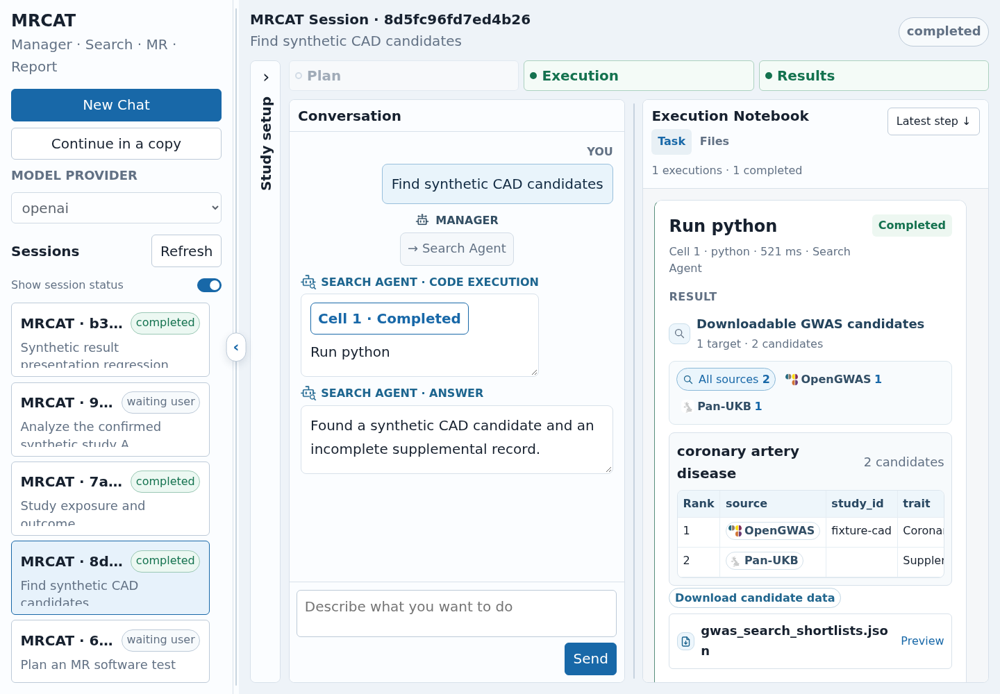

# MRCAT

MRCAT is a skill-guided agent for Mendelian randomization (MR). It finds GWAS datasets,
prepares exposure–outcome inputs, runs MR methods and diagnostics, and writes reports
from saved evidence. Follow-up questions can reuse results within the same session.



The interface above uses synthetic test records.

## Install

Linux and Python 3.11 or newer are required. The analysis tools also need R and
specialist MR packages. Run these commands from the cloned repository:

```bash
conda env create -f environment.yml
conda activate mrcat
Rscript scripts/install_r_dependencies.R
cp .env.example .env
```

Set your provider, API key and model in `.env`. Reference datasets are prepared
separately; see [data and reference resources](docs/data.md). The environment is an
installation recipe, not a complete dependency lock.

For a Python environment that already has R and the required libraries:

```bash
python -m pip install .
```

The Python distribution includes the Skills, prompts, R wrappers and Web assets.
Python installation alone does not install the specialist R packages or reference data.

## Start

```bash
mrcat-web --port 7869
```

Open <http://127.0.0.1:7869> and select the provider configured in `.env`.
Ask a research question, inspect the proposed analysis
plan, and confirm it to start. The console provides the conversation, execution
Notebook, result tables, plots and downloadable files. It supports study setup
with local files, stopping a turn, and continuing an idle session in a copy.

The same agent is available from the command line:

```bash
mrcat --question "Find GWAS studies of systolic blood pressure and coronary artery disease."
mrcat --session session_ID
```

Configuration is read from the current directory by the command-line entry points.
`MRCAT_CONFIG_DIR` selects another directory containing `.env` and `config.yaml`.
`--env-file /path/to/settings.env` selects an explicit environment file. Exported
variables take priority, followed by the explicit file and then the directory's `.env`.
Outputs default to `runtime_artifacts/` in the current directory; use
`--artifact-dir /path/to/sessions` to choose another location.

## Analysis tools

The [26 built-in Skills](docs/skills.md) cover GWAS search, selection, download,
QC and pair preparation; primary and alternative MR estimators; and sensitivity,
bidirectional, mediation, replication and cross-result summaries.

Tools can also be called directly from Python:

```python
from pathlib import Path
from mrcat.tools import mr_primary

result = mr_primary(
    mrdat_path=Path("prepared_pair.tsv"),
    output_dir=Path("outputs/primary"),
)
print(result["summary"])
```

This example requires a prepared MR table with the fields and effect scale
documented in [mr-primary](skills/mr-primary/SKILL.md). Tool completion is an
execution status; study selection, estimator assumptions and causal interpretation
still need scientific assessment.

## Model configuration

Supported providers are `anthropic`, `openai`, `deepseek`, `qwen`, `glm`, `grok` and
`custom`. Use the provider's `*_API_KEY`, `*_MODEL` and, when needed, `*_BASE_URL`.
The `custom` provider uses an OpenAI-compatible endpoint. `REPORTER_MODEL` optionally
overrides the report model. `MRCAT_CODING_AGENT_PROVIDER` optionally selects a
provider for custom coding items; otherwise it inherits the process provider.

`LLM_BACKEND=sdk` and `LLM_BACKEND=http` select explicit transports. A transport
failure is reported without switching protocols. Hosted search has its own
`SEARCH_PROVIDER` setting and retains its documented DeepSeek-to-OpenAI fallback.

Set `MRCAT_CONTEXT_TOKENS` to the model's full context capacity,
`MRCAT_MAX_OUTPUT_TOKENS` to the initial output budget and
`MRCAT_MAX_RETRY_OUTPUT_TOKENS` to the cap for one truncation retry. These limits
are declared by the user, not discovered from the model service.

## Repository

```text
mrcat/       Agent, graphs, model gateway, result storage and Web console
skills/      Skill guides, Python wrappers and R analysis scripts
benchmarks/  Query set and benchmark usage
scripts/     R dependency installation
tests/       Runtime, scientific-output and browser checks
docs/        Architecture, Skills, data preparation and benchmarking
```

See [architecture and session storage](docs/architecture.md),
[Skills](docs/skills.md), [reference data](docs/data.md), and
[benchmarking](docs/benchmarking.md).

## Development

```bash
python -m pip install -e ".[dev]"
ruff check mrcat skills tests
python -m pytest -m "not r and not sandbox" -q
python -m pytest -m r -q        # needs the documented R environment
python -m pytest -m sandbox -q  # also needs bubblewrap and user namespaces
python -m build
```

The default CI checks Python code, offline runtime behavior and package building.
The R and sandbox groups exercise additional dependencies. Test results do not
establish live-model scientific accuracy or reproduce historical benchmark scores.

## License and citation

Original MRCAT code is provided under [BSD-3-Clause](LICENSE). Third-party
components retain their own terms; see [THIRD_PARTY.md](THIRD_PARTY.md).
Software citation metadata is in [CITATION.cff](CITATION.cff). Identify experiments
by the actual software commit, inputs and recorded configuration.
