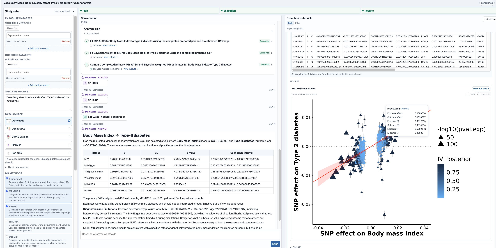

<div align="center">

# MRCAT

**An AI assistant for Mendelian randomization**

Find GWAS studies, run analyses and explore the evidence in one workspace.

[](pyproject.toml) [](https://wiki-northern-diploma-cumulative.trycloudflare.com/)

[Quick start](#quick-start) · [Model configuration](docs/configuration.md) · [Examples](#examples) · [Reference data](#reference-data) · [Documentation](#documentation) · [Checks](https://github.com/77JULIE/MRCAT/actions/workflows/ci.yml)

</div>

MRCAT turns a research question into a reviewable MR workflow. It searches for
studies, prepares exposure and outcome data, runs MR methods and diagnostics,
and writes reports grounded in the saved results. You can inspect the proposed
plan, follow the execution and ask follow-up questions in the same conversation.

[](docs/assets/mrcat-workspace.png)

*The MRCAT interface displaying the included Result 4 recording. This is a
read-only view of an existing analysis; viewing it makes no model calls.*

## What you can do

- **Find studies:** search GWAS sources and review candidate datasets and metadata.
- **Analyze data:** start from online studies or local files; prepare inputs and
  run MR estimators, sensitivity analyses, replication and other supported workflows.
- **Inspect the work:** expand code and execution outputs, explore tables and
  figures, and open or download the scientific report.
- **Continue a question:** reuse suitable saved evidence in a follow-up analysis,
  or continue in an independent copy of a session.

See the [26 built-in Skills](docs/skills.md) for their inputs and requirements.
Completed execution does not establish causality: interpret results with the
study design, ancestry, assumptions and diagnostics.

## Quick start

<a id="install"></a>

### 1. Install

Use **Linux**, **Conda** and **Git**. The environment recipe installs Python 3.11,
R and the Python package. Clone the repository (access is required while it is
private), then run:

```bash
git clone https://github.com/77JULIE/MRCAT.git
cd MRCAT
conda env create -f environment.yml
conda activate mrcat
Rscript scripts/install_r_dependencies.R
```

The R installer is needed for scientific analysis; you can skip it when only
viewing the recorded example. Reference data and GWAS inputs are prepared
separately in [Reference data](#reference-data). The environment recipe is not
a complete dependency lock.

### 2. Configure a model

Create your local settings file once:

```bash
cp .env.example .env
```

If you already have `.env`, edit it instead of replacing it. Open `.env` in a text
editor and update the existing entries below. This example uses DeepSeek:

```dotenv
LLM_PROVIDER=deepseek
DEEPSEEK_API_KEY=your_api_key_here
DEEPSEEK_BASE_URL=https://api.deepseek.com
DEEPSEEK_MODEL=deepseek-flash
```

Replace `your_api_key_here` with your own key from the
[DeepSeek platform](https://platform.deepseek.com/). The model name and endpoint
follow the [provider's API guide](https://api-docs.deepseek.com/).
Model calls use your provider account. Keep `.env` private.

Only configure the provider you intend to use; leave other API keys blank.
The template's model capacity settings also need to fit the model served by your
endpoint; see [model limits](docs/configuration.md#model-limits).
For OpenAI, Qwen or another supported provider, follow the
[configuration guide](docs/configuration.md#choose-a-provider).

### 3. Start and try a question

Run from the repository root with the `mrcat` environment active:

```bash
mrcat-web --port 7869
```

Open **http://127.0.0.1:7869** in your browser. Open **Settings** in the sidebar
and select **deepseek** under **Model provider** to match the example configuration,
then select **New Chat**.
Try a first question that does not require GWAS downloads or R analysis:

> Explain what study information I should prepare for a two-sample MR analysis
> of BMI and type 2 diabetes. Do not search, download data or run an analysis yet.

A response in **Conversation** confirms that this session can reach the configured
model. The provider menu selects credentials already configured on the server;
it does not collect API keys. After changing `.env`, restart the server and
create a new chat. See [troubleshooting](docs/configuration.md#troubleshooting)
if the request fails.

**Want to inspect an existing analysis first?** Select **Result 4 ·
Hexadecanedioate → CAD** in the sidebar. Viewing this recording needs no API key,
reference database or original GWAS files. You can skip step 2 for this view.

## Using the workspace

| Area | How to use it |
| --- | --- |
| Sidebar | Start or reopen a session, choose a configured provider, or open the recorded example. |
| Study setup | Supply local exposure/outcome files and study metadata when using your own data. |
| Conversation | Ask a question, review the proposed plan and confirm before analysis proceeds. |
| Execution Notebook | Expand execution cells to inspect code, outputs, tables and plots. |
| Reports and downloads | Open the generated report and save the available result files. |

For a new scientific analysis, prepare the required data first. Then ask a
specific question, inspect the selected studies and settings, and confirm the
plan. Outputs appear as execution progresses. The
[BMI → T2D tutorial](examples/bmi_t2d/README.md) provides example requests for
online data, local data and an MR-APSS follow-up.

## Reference data

The installer provides **one complete set**: HapMap3/MHC lists, European LDSC,
the European GRCh37 panel, EUR/AFR/EAS/SAS GRCh38 panels and PLINK for Linux x86_64.
It downloads approximately **2.92 GB** and installs **12.86 GB**; allow at least
**16 GB** of free space, plus space for study data and analysis outputs.

**The reference archives have not yet been published.** If you have the prepared
archives from the maintainer, install and verify them with:

```bash
python scripts/download_database.py --from-dir /path/to/database-bundles
python scripts/download_database.py --check
```

Replace `/path/to/database-bundles` with the actual archive directory.
The command `python scripts/download_database.py` will support network
installation after the archives are published and the download URL is configured.
It is not a working public download yet. GWAS study inputs are separate.

See [data preparation](docs/data.md) for sources, storage locations and provenance.
The standard pair-preparation workflow uses European LDSC background files;
AFR/EAS/SAS PLINK panels do not make that background population-specific.

Paper experiment inputs, recorded agent runs and benchmark scores are deposited on Zenodo (reserved DOI: `10.5281/zenodo.24056307`; currently an unpublished draft).

## Examples

| Example | What it provides |
| --- | --- |
| [Result 4: hexadecanedioate → CAD](examples/result4/README.md) | An included read-only recording of MR analysis, FinnGen replication and the final report, with code, plots and selected outputs. |
| [BMI → T2D](examples/bmi_t2d/README.md) | A guided live demo and workflow tutorial; see the preview link and run-status qualifications below. |
| [Offline installation check](examples/offline_smoke.py) | Run `python examples/offline_smoke.py` to check conversation persistence with a fixed local model fixture. It makes no API calls and performs no MR analysis. |

<details>
<summary>BMI → T2D live demo and online recordings</summary>

Try the [BMI → T2D interactive demo](https://wiki-northern-diploma-cumulative.trycloudflare.com/)
without signing in or supplying an API key. This is a **temporary preview URL**;
it may change or become unavailable when the preview tunnel restarts.

The guided example stays in one session:

1. Search the literature, then select online GWAS studies and run MR.
2. Load the supplied native local GWAS files and run a separate MR analysis.
3. Follow up with MR-APSS using the same local studies and suitable QC outputs.

Click an example question to fill the chat input, edit it, or type your own question.
Online and local suggestions include a removable selection of prepared example data.
Review and confirm the proposed analysis plan in the conversation.
The server runs the agent and analysis tools to generate results and plots;
this is not a recording. Verified pre-QC downloads can be reused, while QC,
pair preparation, MR fitting and plotting run for the new session. The host
provides the model credentials, data and analysis dependencies. Progress and
errors remain visible; runtime depends on the model, tools and external services.

See the [BMI → T2D guide](examples/bmi_t2d/README.md) for hosting with `--auth demo`,
input provenance and checksums, and the manual tutorial. Full GWAS inputs are
not bundled in Git. The historical tutorial run completed the primary analyses
but not its MR-APSS follow-up; publishing this live interface does not establish
that the entire sequence has been rerun successfully.

For an immediately viewable completed analysis, open the
[public Result 4 recording](https://result4.mrcat.science/#example-result4).

</details>

## Documentation

| Guide | Contents |
| --- | --- |
| [Configuration](docs/configuration.md) | Provider settings, model limits, session locations, CLI use and troubleshooting. |
| [Data preparation](docs/data.md) | Reference resources, local GWAS inputs and R dependencies. |
| [Skills](docs/skills.md) | Supported workflows and their input/output contracts. |
| [Architecture](docs/architecture.md) | Agent execution, state and result handling. |
| [Shared deployment](docs/multi_user.md) | Cloudflare Access and separation of user sessions. |
| [Development](docs/development.md) | Repository layout, tests, builds and Python tool usage. |

## License and citation

Original code is licensed under [BSD-3-Clause](LICENSE). Third-party code and
data retain their own terms; see [THIRD_PARTY.md](THIRD_PARTY.md).
Use [CITATION.cff](CITATION.cff) for software metadata and record the exact commit
used for an analysis. Author metadata currently lists MRCAT contributors and
is provisional.
