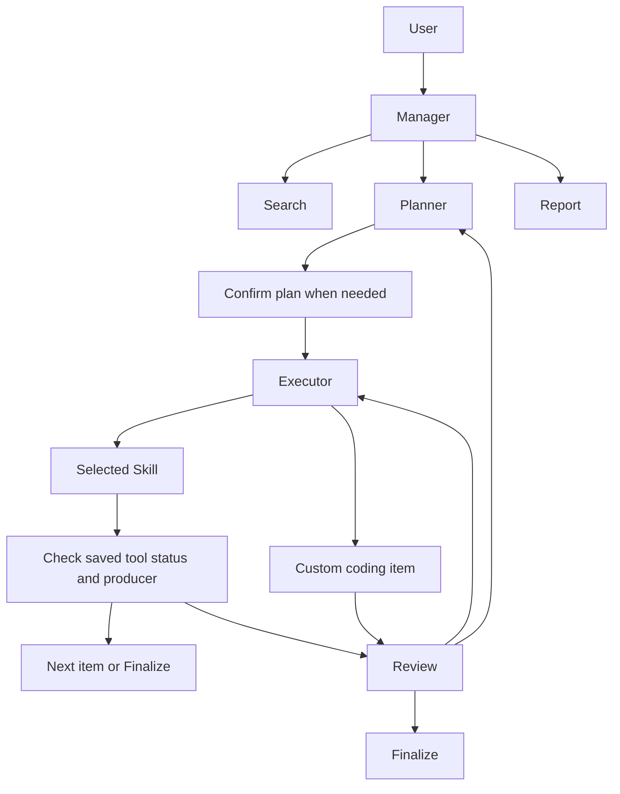

# Architecture and session storage

## Analysis flow

The Manager interprets a user turn and answers directly or routes it to Search,
MR or Report. Search and Report have their own workflows. MR owns planning and
the analysis task lifecycle.

Plans are ordered lists of `step_id`, `title`, `skill_id` and `reuse_from`.
The Executor resolves actual saved results when a step runs. A successful selected
Skill advances after its saved status and producer are checked. Custom coding
items enter Review before acceptance. Replanning retains compatible completed work.
Report selects evidence, verifies supporting literature, writes a draft and runs
an automated Judge before exporting an accepted report.

## Code map

| Module | Responsibility |
| --- | --- |
| `mrcat/agent.py` | Shared model, context and task helpers |
| `mrcat/graph.py`, `manager.py` | Conversation routing and persistent user pauses |
| `mrcat/mr.py`, `plan_items.py` | MR steps, Review, replanning and Finalize |
| `mrcat/codeact.py`, `coding_agent.py` | Skill and custom-code execution loops |
| `mrcat/execution.py` | Child processes, logs, cancellation and execution receipts |
| `mrcat/store.py`, `checkpoints.py` | Authoritative checkpoint storage |
| `mrcat/results.py` | Saved result publications and explicit references |
| `mrcat/tools.py`, `tool/mr/` | Public tool functions and shared MR helpers |
| `mrcat/report/` | Evidence selection, literature, writing, review and export |
| `mrcat/web/` | HTTP API, session projections and static frontend |

## Session files

Each `session_<id>/` contains a workspace, execution receipts, tool results and a
`graph.sqlite` entry. LangGraph checkpoints are the authority for session and
control state. Exported conversation, memory and plan files are readable projections.
The public release supports the current checkpoint schema. It does not import old
`session.json` workflows.

SQLite must be on a local filesystem. For sessions on NFS or similar storage,
`graph.sqlite` links to a database under `/var/tmp/mrcat-<uid>/checkpoints/`.
Set `MRCAT_CHECKPOINT_DIR` to select a persistent local location. Preserve that
location while sessions are needed. Copying the session directory alone does not
back up a linked database. Stop writers and back up the resolved SQLite database
and session files together before moving them.

Interrupted code is not automatically replayed. A completed receipt can restore
an observation without recomputation; otherwise inspect the saved evidence before
retrying. Resume, stop, cancellation and process-crash behavior have separate tests.

## Results and execution boundaries

Tools publish outputs with their producer, arguments, status and execution ID.
`$ref` resolves a current-scope result; `$taskref` explicitly addresses another
scope in the same session. Replanning can invalidate a producer without deleting
its historical evidence. A failed or invalidated result cannot be reused as success.

Scientific checks remain in their owning tools: effect scale, input statistics,
variant selection, LD resources and estimator requirements are not presentation
options. Saved evidence supports reporting; an exit code alone does not validate a
causal conclusion.

Ordinary Web and CLI code runs with the launching user's OS permissions. Use the
localhost default for a personal installation. The benchmark worker additionally
uses a bubblewrap filesystem boundary, described in [benchmarking](benchmarking.md).

The Web API uses `/api/sessions`, `/api/methods`, and `session_id` consistently.
Events are delivered as `snapshot` and incremental `events` messages. File access
is restricted to the session's deliverables and execution observations.
